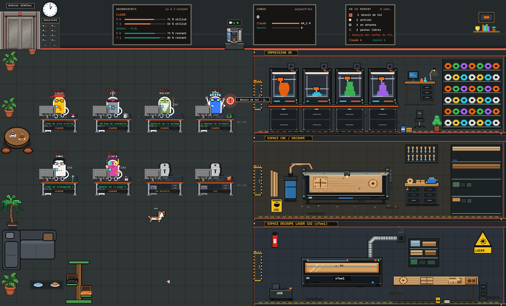
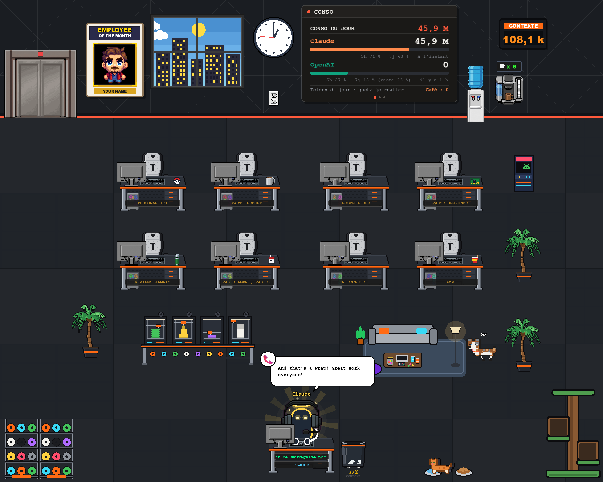

# Bureau entreprise

**Un bureau pixel art qui montre en direct tes sessions Claude Code et Claude (appli desktop).** Chaque conversation a son poste de travail, ses agents, ses tokens et ses pauses café. Tout tourne **en local** (http://localhost:8000, 127.0.0.1 uniquement), sans IA ni jeton consommé.

> Fork personnalisé de [Claude Office Visualizer](https://github.com/paulrobello/claude-office) (v0.24.1) de Paul Robello, licence MIT. Voir `LICENSE`.

## Aperçu

Captures prises avec des données fictives (noms de conversations et prénoms d'agents inventés).

**Vue « Conversations »** : un bureau par conversation, tableaux d'abonnements / conso, salles atelier.



**Vue « Bureau »** : le bureau classique avec l'agent principal, la cafetière et la conso du jour.



## Démarrage rapide (Windows)

Prérequis : Python 3.12+, Node 20+, [uv](https://docs.astral.sh/uv/).

```powershell
# 1. Backend
cd app\backend ; uv sync        # ou : python -m venv .venv ; .venv\Scripts\pip install -e .

# 2. Interface (export statique servi par le backend)
cd ..\frontend ; npm install ; npm run build
Copy-Item out ..\backend\static -Recurse

# 3. Hooks Claude Code (outil claude-office-hook + entrées dans ~/.claude/settings.json)
cd ..\..
uv tool install .\app\hooks
python app\hooks\manage_hooks.py install --hook-cmd claude-office-hook

# 4. Lancer
powershell -File outils\demarrer.ps1     # ouvre http://localhost:8000
```

Ouvre ensuite une session Claude Code : un agent apparaît. Arrêter : `outils\arreter.ps1`. Tout retirer (hooks et outil) : `outils\desinstaller.ps1`. Autre système que Windows : `app/README.md` (Make, tmux, Docker).

**Avec Claude Code** : ouvre le dépôt et demande « installe et lance Bureau entreprise » ; [CLAUDE.md](CLAUDE.md) lui donne tout ce qu'il faut.

## Ce qu'il y a en plus de l'original

- **Vue « Conversations »** : scène fixe 1920×1164, un bureau par conversation, ascenseur, cafetière, salles atelier / impression 3D.
- **Cafés** : un agent qui attend plus de 5 min va chercher un café ; compteur global et badge `xN` par conversation.
- **Tokens et conso du jour**, ligne OpenAI affichée seulement si OpenAI est connecté.
- **Chien et chats** qui se promènent dans le bureau.
- **Sauvegardes automatiques** de l'historique (3 dernières gardées).
- **Scripts Windows** : lancer / arrêter / désinstaller / faire un paquet portable (`outils/`).

## Comment ça marche

```
Claude Code ──hooks──▶ FastAPI :8000 ──WebSocket──▶ navigateur (PixiJS)
```

Les hooks envoient chaque événement de session au backend local, qui met à jour l'état des agents et le pousse à l'interface. Détails : [docs/ARCHITECTURE.md](docs/ARCHITECTURE.md).

## Le personnaliser

| Je veux changer… | Où |
|---|---|
| Mon nom sur « Employé du mois » | `app/frontend/src/components/game/EmployeeOfTheMonth.tsx` (`YOUR NAME`) |
| Prénoms des agents, chien, chats | `app/backend/app/config.py`, `app/frontend/src/constants/` |
| Logo / icône | `assets/logo.png`, `assets/logo.ico` (`outils/make_logo.py`) |
| Décor et personnages | `outils/make_decor.py`, `outils/apercu_*.py` |
| Salles, délai des cafés, plaques | `app/frontend/src/components/conversations/` |
| Port et adresse | `outils/demarrer.ps1` (le front suppose le port 8000) |

Le tableau complet, plus faire une démo avec de fausses données : [docs/PERSONNALISER.md](docs/PERSONNALISER.md). Après toute modif de l'interface : `npm run build`, recopier `out` vers `app/backend/static`, relancer.

## Problème ?

Page vide, ancienne version servie, aucune conversation : voir [docs/DEPANNAGE.md](docs/DEPANNAGE.md).

## Confidentialité

Rien ne quitte ta machine. Le backend écoute en 127.0.0.1, les hooks lisent seulement les événements de tes sessions. Ne publie jamais ton `.env`, tes `sauvegardes/` ni tes `logs/` (déjà dans `.gitignore`).

## Licence

MIT, copyright Paul Robello pour le code d'origine. Les ajouts de ce fork sont publiés sous la même licence.
